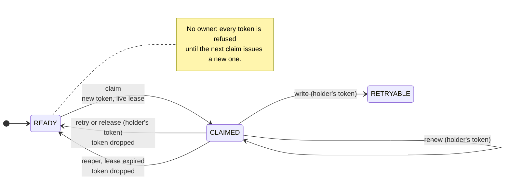

# Fenced lease

**What it models.** [`InMemoryOwner`](../../../../../package/src/pytest_obligation/references/in_memory.py)
is the reference implementation of profile B ("bounded ownership"): a worker claims a row, holds
a lease while it works, and proves ownership with a token on every write. The profile B proofs in
[`bounded_ownership.py`](../../../../../package/src/pytest_obligation/profiles/bounded_ownership.py)
are calibrated against it, so if it is wrong, every adopter with the same bug passes profile B.

**The rule.** A token stops working the moment its row has no owner: when the reaper takes the
row back, or the owner retries or releases it. Not only once someone else claims it.

**The bug it found.** Before #217, the reaper put a stalled row back to `READY` but kept the dead
owner's token valid until the next claim. That owner, waking up, could renew a lease on the
unowned row or write it to `RETRYABLE`, where no claim and no reaper would ever reach it again.



Every other call, including any call with a token that is not the holder's, is refused and
changes nothing.

## How it is checked

[`model.qnt`](model.qnt) states the rule for one row. Quint generates histories from it (five named
witnesses and eighteen random samples); for each, [`conftest.py`](conftest.py) applies every step to
a real `InMemoryOwner` and reads the row back. Any difference fails the test.

| Model action | Real call |
| --- | --- |
| `claim` | `InMemoryOwner.claim()` |
| `expire` | `expire_lease(row)`: the owner stopped renewing |
| `reclaim` | `reclaim_stalled(row)`: the reaper |
| `write(token)` / `retry(token)` / `release(token)` / `renew(token)` | `fenced_write`, `fenced_retry`, `release_unchanged`, `renew_lease`, with the last or previous token issued |

The model observes the row's state, its lease (none, live or expired) and whether the call was
accepted. Which token holds the row is model-only state: the API does not expose it, so the model
shows its effects instead.

```sh
uv run --no-sync pytest -c contracts/quint.ini contracts/pytest_obligation/references/in_memory/fenced_lease
```

## Planted bugs

Each is a deliberately broken owner; some generated history must catch it, or the contract is too
weak to notice that kind of bug.

| Planted bug | What it breaks |
| --- | --- |
| `shipped-9aa6ff2` | The code as shipped before #217, from [`history/rearm-9aa6ff2.py.txt`](history/rearm-9aa6ff2.py.txt) (verbatim, SHA-256 pinned): re-arming keeps the dead owner's token |
| `reaper-ignores-lease` | The reaper takes a row whose lease is still live |
| `unfenced-renewal` | Renewal ignores the token |

## Files

| File | Role |
| --- | --- |
| `model.qnt` | The Quint model: the rule, the actions, the witnesses |
| `quint-connect.json` | The manifest: actions mapped to real calls, bounds, planted bugs, the bug found |
| `fenced_lease_driver.py` | Generated by `pytest-quint-connect codegen quint-connect.json`. Never edit; regenerate after changing the model |
| `conftest.py` | The driver: implements each generated action against the real code, plus the planted bugs |
| `test_fenced_lease_contract.py` | Declares the contract for pytest |
| `history/` | Frozen evidence, never edited: the shipped pre-fix code |

## Limits

One row, the reference's own clock (which never advances) and at most eight calls per history. This
checks the reference, not an adopter's binding; adopters are judged by the profile B proofs.
Change `InMemoryOwner`, the model and the driver in the same pull request.
