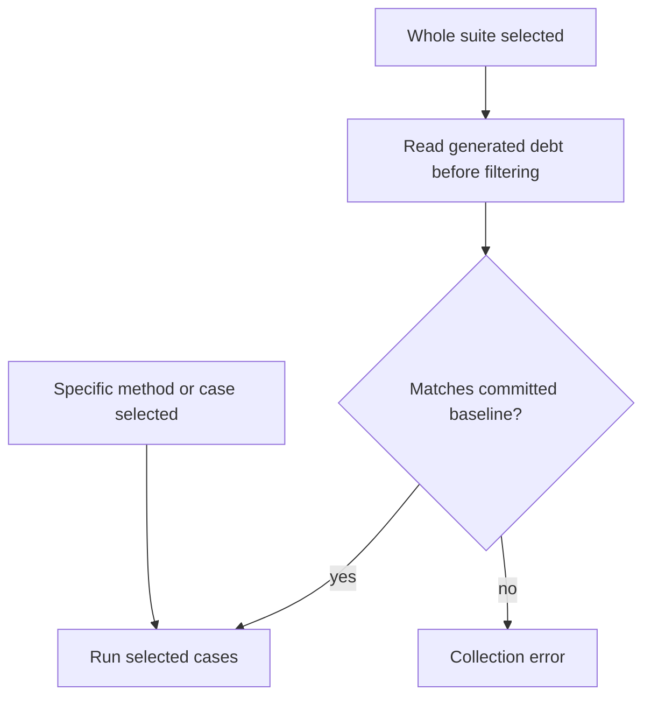

# Keep generated debt visible

Use `pytest_obligation.debt.assert_debt_baseline(root, baseline=...)` in project
policy tests to audit deleted or renamed suites and malformed ticket references.
Its `unticketed_ceiling` defaults to zero. An existing reviewed allowance must
match the actual unticketed count, so fixing or ticketing debt requires lowering
the allowance. Per-suite execution checks still apply. This global audit replaces
adopter copies of the same checks.

A green run can include strict expected failures. `NotAssessed` means a production
binding is missing; other generated strict xfails describe known defects. An
application-owned baseline prevents either from changing silently.

```text
contract declarations -> generated cases -> strict xfails -> baseline comparison
                                             |                    |
                                      case ID + kind        fail collection
```

Install `pytest-obligation[debt]` and opt in through pytest configuration:

```ini
[pytest]
due_work_debt_baseline = tests/due_work_debt.yaml
```

The equivalent command is `pytest --due-work-debt-baseline tests/due_work_debt.yaml`.
Paths are relative to pytest's root directory; absolute paths also work. No
baseline is enforced unless configured. YAML is an optional dependency; importing
contracts still needs only pytest and Pydantic.

```yaml
suites:
  - suite: tests.test_checkout.TestCheckout
    debt:
      - case: E-not_assessed
        kind: binding-debt
        reason: The production supersession path has not been bound yet.
      - case: A-known_gap
        kind: known-defect
        ticket: https://github.com/example/shop/issues/42
        reason: Recovery currently stops at the first failed identity.
```

Use the exact generated IDs from `pytest --collect-only`. Known defects require
an issue URL or a key such as `PROJECT-42`. Legacy `TODO` entries remain readable;
applications should separately ratchet their count downward. Reasons are for
readers, while IDs and kinds must match exactly. Added, removed and reclassified
entries fail collection. Duplicate suites or case IDs are rejected.



`-k` and `--deselect` do not bypass comparison. Explicit method/case node selectors
skip comparison because they do not collect the full suite. A broad selector
alongside a narrow selector still requires the full suite. Comparison runs on
xdist workers too.

For an intentional reviewed refresh:

```sh
DUE_WORK_DEBT_BASELINE=update pytest --collect-only -p no:xdist tests/test_checkout.py
```

This updates only collected whole suites and preserves surviving issue references.
New defects still need tickets before a normal run succeeds. Review the diff;
regeneration is not approval to accept new debt. Updates refuse xdist workers.
Deleted suites and repository-wide debt totals require an application inventory
check: collection cannot compare a suite that no longer exists.

The public models and comparison functions live in
[`pytest_obligation.debt`](../src/pytest_obligation/debt.py). Plugin dispatch is
internal. [`requires_complete_suite`](../src/pytest_obligation/collection.py)
provides selector semantics for other collection policies.
