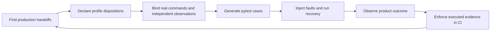

# From production obligation to executed proof

This is the navigation guide for the harness. Start with the question you need
to answer; the linked guides and examples own the details.

| Goal | Guide or executable example |
| --- | --- |
| Enroll a new application | [Adoption walkthrough](../ADOPTING.md), [SQLite adopter](../examples/adopter/) |
| Choose claims and understand their limits | [Profile catalog](../src/pytest_obligation/profiles/catalog.py), [what a green result means](what-a-green-result-means.md) |
| Connect database and worker boundaries | [Integrations](integrations.md), [Host contract](../ARCHITECTURE.md#the-host) |
| Follow recovery through malformed rows and lost messages | [Recovery edge cases](recovery-edge-cases.md), [handoff API](../src/pytest_obligation/crash_histories.py) |
| Exercise ordering and real process death | [Interleavings](interleavings.md), [process histories](../src/pytest_obligation/process_histories.py) |
| Find unenrolled handoffs and source-policy debt | [Coverage](coverage.md), [source policies](source-policies.md) |
| Test a Due work-table application | [Due authoring walkthrough](https://github.com/gigaverse-app/due/blob/main/docs/conformance.md), [Due API and module map](https://github.com/gigaverse-app/due/blob/main/docs/conformance-api.md) |
| Replace the backend's local harness | [Completed port and ownership map](backend-harness-port.md), [package migration](package-migration.md) |
| Change the harness itself | [Architecture](../ARCHITECTURE.md), [contributing](../CONTRIBUTING.md), [upstream adopter playbook](upstream-playbook.md) |

The Due API guide is introduced in [Due #9](https://github.com/gigaverse-app/due/pull/9);
use that PR's version until it lands on `main`.

## The workflow



1. Inventory production handoffs with `pytest-obligation check`; a passing
   selected test cannot discover a capability whose suite was deleted.
2. Declare an `ObligationContract` and an explicit disposition for each relevant
   profile. The [adoption guide](../ADOPTING.md) explains `Claim`, `Decline`,
   `NotApplicable`, `KnownGap` and unassessed evidence.
3. Bind real production selections and transitions. Test code may arrange data,
   inject failures and observe results; it must not supply a second recovery loop.
4. Generate cases with `due_work_contract_suite`. Configure a framework host once
   per test session when the proofs need transaction, clock or worker boundaries.
5. Run both healthy controls and injected histories. A fault that never fires is
   not evidence that recovery handled it.
6. Enforce collected, selected and executed evidence. Consult the
   [adoption CI workflow](../ADOPTING.md) and preserve report artifacts alongside
   JUnit; a filtered green run cannot establish complete application coverage.

## Who owns what?

```text
Application
  commands + product state + provider seams + schedules + reviewed exceptions
        |                                           |
        v                                           v
  Public contract / history APIs              coverage policy APIs
        |                                           |
  Shared proofs and fault runners             private AST analysis
        |
  Host and explicit framework integrations
        |
  Production database / workers / providers
        |
  Independent product observation

Due work-table adopter:
  Due conformance declarations -> Due bindings -> shared proofs above
  Due runtime remains the owner of claim, retry, recovery and settlement
```

The core imports no framework. A host supplies framework boundary operations;
it does not redefine the obligation. Due's adapters live in Due because they
bind its coordinator, registry and schema. Application manifests, expected
product outcomes and reviewed policy exceptions remain in the application.

## Public interfaces and implementation details

| Interface | Contract |
| --- | --- |
| [`contract`](../src/pytest_obligation/contract.py) | Declarations, profile dispositions, generated cases and suite decorators. Start here. |
| [`host`](../src/pytest_obligation/host.py) | `Host`, `configure`, `hosted`: transaction, connection, clock, fault and selection-inspection boundaries. Missing required capabilities fail explicitly. |
| [`crash_histories`](../src/pytest_obligation/crash_histories.py) | `HandoffHistory`, `ExternalCall`, `Delivery`, `DeliverySession`, `RecoveryDeliverySession`: arrange, interrupt, deliver/drop, recover and observe. |
| [`process_histories`](../src/pytest_obligation/process_histories.py) | Real child-process histories and fault markers; application code owns child initialization and durable external resources. |
| [`interleavings`](interleavings.md) | Public scenario, replay and callback contracts; deterministic runner internals live under `engine/`. |
| [`coverage.transactions`](../src/pytest_obligation/coverage/transactions.py) | Transitive pre-commit publication evidence and exact reviewed exceptions. |
| [`coverage.schedules`](../src/pytest_obligation/coverage/schedules.py) | Schedule classifications, call-chain evidence and heartbeat cadence checks. |
| [`coverage.proof_calls`](../src/pytest_obligation/coverage/proof_calls.py) | Optional application policy requiring direct proof calls to have reviewed dispositions. |
| [`integrations`](integrations.md) | Explicit framework adapters. Install the matching extra and configure the host; importing the core does not load them. |

`coverage/_internal/` owns AST visitors, call graphs and source-shape helpers.
Adopters import the public policy modules; tests of those algorithms may import
private helpers. Public imports did not change when those details moved.
Reference models under `references/` are controls for the harness's own tests,
not substitutes for binding an application's runtime.

## Scope and outcome rules for handoff histories

`HandoffHistory.arrange` may return a handle or a context manager yielding a
handle. Its context stays open through fault injection, recovery and observation,
including cleanup on failure. `transition(handle)` must be the real production
entry point. `observe(handle)` must return a comparable snapshot; omit incidental
identifiers and timestamps that differ between repetitions.

An optional `expected` value supplies an independent product oracle. A callable
is evaluated on the arranged handle **before** the transition. Explicit `None`
is a valid expected result. With `expected` omitted, the runner compares against
the uninterrupted delivered history; equal histories can still share a product
bug, which is why independent expectations matter.

`recovery_ticks` names real downstream recovery entry points. A compatible
session implements `recover_with(ticks)` and owns the bounded execution order;
unsupported sessions reject the declaration instead of ignoring it. Due's
`WorkTableDelivery` implements this protocol. Binding validation applies to each
downstream tick, just as it does to the primary production transition.

Django hosts configured with `ambient_context` also register the ambient-state
restoration proof. The accessor must return a comparable snapshot of the context
that a recovery tick is required to restore.

## Debugging a failed adoption

| Symptom | Useful next step |
| --- | --- |
| Binding rejected as test-authored | Bind the production method directly; keep arrangement and observation separate. |
| Failure seam did not fire | Check the named external boundary and positive control before interpreting recovery. |
| History converges to the wrong value | Supply/check the independent `expected` product outcome. |
| Declared downstream recovery is unsupported | Use a session implementing `RecoveryDeliverySession`, or bind a complete production recovery sequence. |
| Green tests but incomplete report | Check selection, skips/xfails, required profiles and independently inventoried enrollment. |
| Source scan reports incomplete analysis | Fix configured source roots, hidden files or unparsable modules; do not accept a partial inventory. |

A passing proof establishes the bound behavior over the histories it executed.
It does not prove all schedules, all database values or exactly-once external
execution. Keep those limits visible in the application's own adoption report.

## Checked declarations and debt

[The debt baseline guide](debt-baseline.md) explains how to prevent generated
expected failures from silently accumulating.

With the Django host, profile J `NotApplicable` now inspects the production
selection for integer attempt/retry/rearm counter comparisons. It rejects a
visible retry budget. Time comparisons such as `retry_at__lte` are not counters;
application code and computed annotations can still contain budgets this scan
cannot detect.

Owed-row checks also reject exceptions after a claim or backoff removes a row
from the selection. A native contract must prove a terminal state or claim J
without gaps. A light selection has neither guarantee and must fix or explicitly
record the defect. A `still_owed` binding must answer for the specific row: the
harness checks that a row served to completion is no longer owed while the
poisoned row remains owed.


### Index conditions need catalog evidence

An `Index Cond` on the second key of `(campaign_id, state)` can still read the
whole B-tree on PostgreSQL 16. The Django inspector now captures key order,
access method and partial predicate from PostgreSQL's catalog, and rejects that
plan unless its leading key is constrained or its partial predicate bounds the
selection. A bitmap of a partial index is accepted automatically when it serves
the whole selection; joins and heap filters still need narrowing evidence.

```text
(campaign_id, state) + WHERE state = 'UNKNOWN' → entire index can be walked
(state, campaign_id) + WHERE state = 'UNKNOWN' → leading key narrows the read
(id) WHERE state = 'UNKNOWN'                  → partial predicate bounds it
```

Direct plan consumers must use
`pytest_obligation.integrations.django.selection.explain_index_eligibility` or
attach equivalent `CATALOG_INDEX` facts. Bare EXPLAIN JSON cannot establish key
order. `integrations.django.indexes.installed_indexes` exposes the same canonical
catalog records for schema proofs, so downstream adapters need no duplicate SQL.
