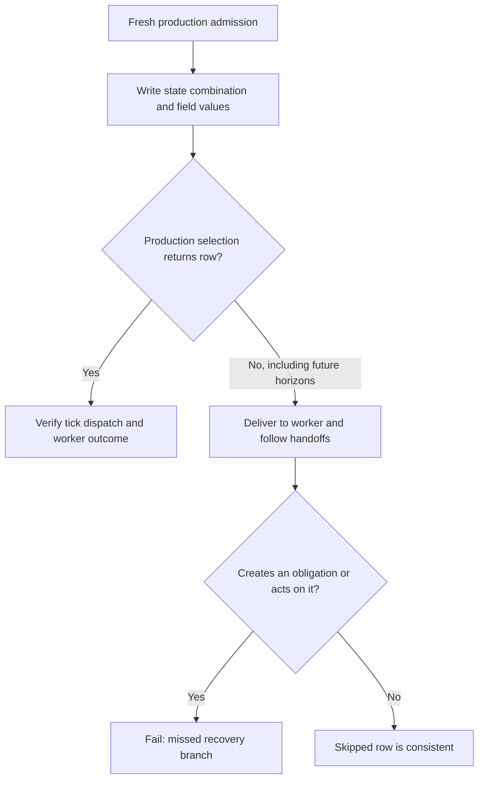

# Prove that recovery selects every owed branch

A worker can handle every row in your examples while its recovery query silently
omits another lifecycle branch. Selection completeness perturbs real rows, calls
the production selection and worker, and checks both sides of the query.

```text
fresh owed row -> state combinations + database-legal field values
                                      |
                         production selection
                         /                    \
                    selected                skipped
                       |                       |
             tick dispatches it       worker must leave it alone
             worker serves it         at every tested horizon
```



Install `pytest-obligation[django,exploration]`, configure `django_host`, and
provide the queue's handoff runner when workers publish further work. The core
plugin stays independent of Django and Hypothesis until this proof is requested.

For a native lifecycle, add `prove_selection_complete=True` to your
`ObligationContract` with a claimed profile A and a sweep whose `Lifecycle`
names the state paths. Existing `owed_model`, worker and outcome bindings still
apply. For a per-row scheduled loop:

```python
selection = ScheduledSelection(
    name="batch recovery",
    due_work=items_awaiting_dispatch,  # actual production queryset
    owed_rows=bind_batch_loop,  # existing OwedRows factory
    owed_edges={"item": EdgeFamily(model=BatchItem)},
    state_fields=("state", "batch__status"),
    excluded_states={
        "state:done,batch__status:running": "The completion sweep owns this combination; see its contract.",
    },
    assert_scheduled=assert_batch_schedule,
)
```

These names are application bindings, not library-provided batch business logic.
A runnable PostgreSQL reference and positive/negative controls live in
[`test_selection_completeness.py`](../tests/django/automatic_recovery/test_selection_completeness.py).

A state path follows forward relations and ends at a field with `choices`.
Every combination runs as a fixed example up to 64 combinations; above that,
each individual state is fixed and Hypothesis explores combinations. Other
compared fields contribute generated values and deterministic edges, including
blank and whitespace text. Database-rejected writes are rejected examples.
Default runs add 25 generated examples; `--due-work-explore=deep` adds 200.

A legacy gap must identify one combination, for example
`assert_selection_is_complete[batch__status:running,state:done]`. That combination
runs as a strict xfail accepting only the proof's invariant failures. The search
excludes it; neighboring combinations remain checked. A gap on the entire proof
is refused. Debt baselines continue to record the exact generated case.

`integrations.django.selection_completeness` exposes `CompletenessBinding`,
`assert_selection_is_complete`, `SelectionIncomplete` and the per-combination
gap helpers for runtime integrations. Ordinary adopters use contract declarations.
`selection_cases` compiles them; applications need not import that module.

Limits matter: this is bounded exploration, not an exhaustive database proof.
Related fields are explored only through declared state paths. SQL `NOW()` does
not advance with the application clock. An unselected row changed only through
unobserved external effects or ordinary updates to other existing rows may be
invisible. Supply independent provider counters and outcome observations.
An inline tick used as the worker cannot independently reveal its own skipped
query branches. Due adds the same proof automatically for unbounded discovery;
a declared discovery horizon deliberately covers a narrower population.

## One delivery binding for both checks

`OwedRows` and `CompletenessBinding` inherit the public `RowExecution` contract
from `integrations.django.owed_rows`. Their existing flat keyword constructors
remain valid. `make_owed` arranges a fresh row; `execute` is its production worker;
`deliver` optionally maps that row to worker input; `identity_of` compares stable
identities; `effect_calls_for` observes effects outside SQL.

Both proofs use `serve_row` to run that worker, flush commit callbacks and follow
its handoffs. Its `ServedRow` result records the failure, where it occurred,
whether work happened and which obligations were created. A delivery failure
cannot make selection completeness silently use different evidence from the
owed-row proof. Integrations can reuse this owner; ordinary adopters should keep
using the generated contract declarations above.
