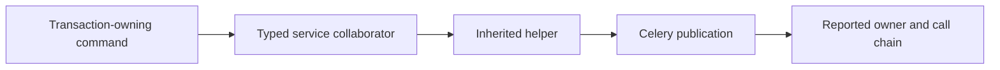

# Source policies for an application harness

The [handoff coverage scan](coverage.md) checks whether handoff sites have a
contract or exemption. These additional APIs let an application enforce its
transaction, schedule and declaration policies. They parse source without
importing application task modules. They produce structural evidence;
[executed conformance](harness-guide.md) establishes behavior.

## Shared configuration

Use the same `CoverageConfig`/`Project` as the handoff scanner. For an installed
project, call `load_config(root)` to read `[tool.due-work-harness]` from
`pyproject.toml`. Or construct configuration explicitly:

```python
from pathlib import Path
from pytest_obligation.coverage.config import CoverageConfig
from pytest_obligation.coverage.project import Project

config = CoverageConfig(
    root=Path.cwd(),
    production_packages=("shop",),
    source_roots=("src",),
    transaction_openers=frozenset({"shop.transactions.product_transaction"}),
)
project = Project(config)
```

Replace `shop` and the source root with your application's layout. Custom
transaction openers are import-qualified names; `.atomic(...)` scopes and
Django's `atomic` decorator are recognized without additional configuration.

## Publications before commit



```python
from pytest_obligation.coverage.transactions import (
    assert_publications_reviewed,
    publications_before_commit,
)

paths = publications_before_commit(config)
assert_publications_reviewed(config, reviewed={})
```

`paths` maps each transaction-owning callable to the reachable publishers and
the shortest resolved call chain. An empty chain denotes a publication directly
in the owner's body. The assertion rejects every publication absent from the
reviewed inventory. For command-line inspection:

```bash
pytest-obligation before-commit --root .
```

If migration debt must remain, the application owns a narrow, explained entry:

```python
from pytest_obligation.coverage.transactions import PublishedBeforeCommit

reviewed = {
    "shop.orders.place": PublishedBeforeCommit(
        reason="Legacy audit notification carries no row identifiers and reads no uncommitted product state.",
        publishers=frozenset({"shop.audit.AuditService.publish"}),
    ),
}
assert_publications_reviewed(config, reviewed=reviewed)
```

That is an adaptation sketch, not a blanket safe-publication rule. New publishers,
stale exceptions, empty publisher sets and explanations shorter than 40 stripped
characters fail. Prefer correcting transaction boundaries to growing the list.

Resolution follows imports, module-level functions, `self` methods, annotated
collaborators, inherited methods and `sync_to_async(f)`. It does not resolve local
object values, `create()` results, abstract port dispatch or dynamic reflection.
Lambda/nested-function calls are not followed. In particular, a callback supplied
to `on_commit` is not treated as executing at its definition site. Hidden or
unparsable production modules fail the scan; unsupported dynamic dispatch remains
a documented resolution limit.

## Installed schedules and heartbeat structure

Applications supply the actual schedule inventory and evaluated policy values;
the scanner never invents a schedule by importing application settings. This
sketch assumes the real `shop.tasks.recover_orders` task reaches
`recovery_tick(...)` through the named production method:

```python
from datetime import timedelta
from pytest_obligation.coverage.schedules import RecoveryTick, assert_schedule_contract

assert_schedule_contract(
    project,
    schedule={"recover-orders": "shop.tasks.recover_orders"},
    sweeps={
        "shop.tasks.recover_orders": RecoveryTick(
            via=("shop.orders.OrderService.recover",),
        ),
    },
    intervals={"shop.tasks.recover_orders": timedelta(minutes=2)},
    default_stale_after=timedelta(minutes=10),
)
```

| Declaration | Evidence and application responsibility |
| --- | --- |
| `RecoveryTick(via=(), returns_before_tick="")` | The task reaches `recovery_tick`; each `via` hop names a production function. Explain an intentional early return; stale explanations fail. |
| `GeneratedRecovery()` | A registered runtime owns the task. Supply its `RecoveryTick` chain in `generated_recovery`; runtime conformance checks installed cadence and gates. |
| `NoPerRowLoop(reason=...)` | A scheduled action without a per-row call loop. The reason must be substantive; a reachable tick contradicts this classification. |
| `Grandfathered(reason=...)` | Explicit migration debt, also named in `reviewed_grandfathered`. Growth and stale entries fail. |

Classifications must exactly cover scheduled task names. Task definitions must be
present in scanned production source. The supported declaration shape is a
`shared_task` function, optionally with a literal or named task-name constant.
Static heartbeat thresholds must equal
`max(default_stale_after, 2 * shortest_interval)`; a nonliteral threshold expression
is reported for review rather than executed. Calls with `heartbeat=False` do not
publish a threshold. The validator does not prove runtime poison isolation,
recovery completeness or dynamic dispatch.

## Require declaration-based enrollment

Applications may allow standalone proofs, or require generated enrollment with a
small reviewed exception list. The library supports both choices:

```python
from pytest_obligation.coverage.proof_calls import assert_declared_proofs

sources = {
    "tests.test_orders": Path("tests/test_orders.py").read_text(encoding="utf-8"),
}
assert_declared_proofs(sources, reviewed={})
```

Use an application-selected complete set of test modules, not just the current
pytest selection. The optional `reviewed` mapping uses `(module, local_proof_name)`
keys and substantive reason strings. Unreviewed calls, stale keys and explanations
shorter than 20 stripped characters fail. `ExtraProof` runners are exempt: they
already participate in generated enrollment. Import aliases are recognized;
local reassignment of proof functions and reflective calls are outside this scan.

## Examples that test the policies themselves

- [Publication graph controls](../tests/core/coverage/test_publications_before_commit.py)
- [Schedule inventory and threshold controls](../tests/core/coverage/test_schedule_inventory.py)
- [Direct-proof declaration controls](../tests/core/coverage/test_proof_calls.py)

These tests build small source projects and exercise both accepted and rejected
cases. AST implementation details live under
[`coverage/_internal`](../src/pytest_obligation/coverage/_internal); applications
use the three public policy modules above.
