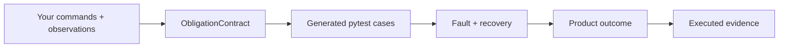
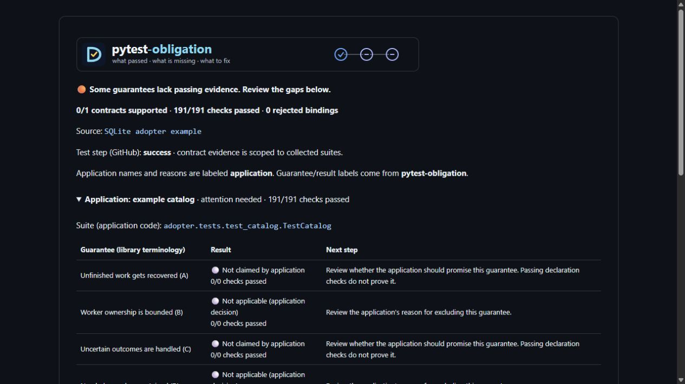

# Find lost work and duplicate effects before production does.

Bind an `ObligationContract` to your application's real commands, recovery and
observable outcomes. pytest-obligation generates pytest cases that inject faults
and check those outcomes. It works with existing application code; Due is optional.

[Start a tutorial](../package/docs/tutorials.md){ .md-button .md-button--primary }
[Run the SQLite example](../package/docs/adopting.md#try-a-complete-example-first){ .md-button }
[Understand the guarantees](../package/docs/how-it-works.md){ .md-button }

New here? The [tutorials](../package/docs/tutorials.md) walk through a checkout
that spans a database, a payment provider, a queue, a cache and email, and a
small task queue that ships generated tests to its users. The
[vocabulary](../package/docs/vocabulary.md) defines each term from the failure it
prevents.

## Install in your test environment

```bash
uv add --dev pytest-obligation
# For Django transaction and database integration:
uv add --dev 'pytest-obligation[django]'
```

The core needs Python 3.11+, pytest and Pydantic. Framework extras add their own
dependencies. Installation registers the pytest plugin; you still need to bind
and collect a contract before any application guarantee is tested.



## Adopt one workflow first

1. [Try the self-contained SQLite application](../package/docs/adopting.md). No
   database server or broker is needed for that example.
2. Choose the guarantees your workflow needs and bind its real boundaries.
   [Framework integrations](../package/docs/integrations.md) supply transaction,
   clock and worker operations; your application supplies product meaning.
3. Run generated tests and [inspect what green means](../package/docs/what-a-green-result-means.md).
   Keep enrollment and executed-profile checks in CI so a skipped suite cannot
   masquerade as completed proof.

A green result applies to the bound histories and observations. An unassessed,
declined or inapplicable profile is not a verified guarantee. Use
[negative controls](../package/docs/false-greens.md) to check that a broken recovery
path actually fails the proof.

## Read the evidence, not just the exit code



This is the actual SQLite example's report rendered locally. All 191 recorded
contract checks passed, but the application deliberately declines guarantees it
does not implement, so the report still asks for review. Counts describe this
example snapshot, not a fixed API promise. [Read and publish the report](../package/docs/github-action-report.md).

## Related tools and support

[Choose a related tool](ecosystem.md) when you also need test selection, CI
measurement or background-work guarantees. Each project works independently.

`latest` follows main and can contain APIs newer than your installed package.
Check the release notes for that version. [Report an issue](https://github.com/gigaverse-app/pytest-obligation/issues)
with a minimal reproducer, or read [the contribution guide](../CONTRIBUTING.md).
